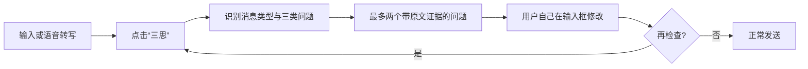
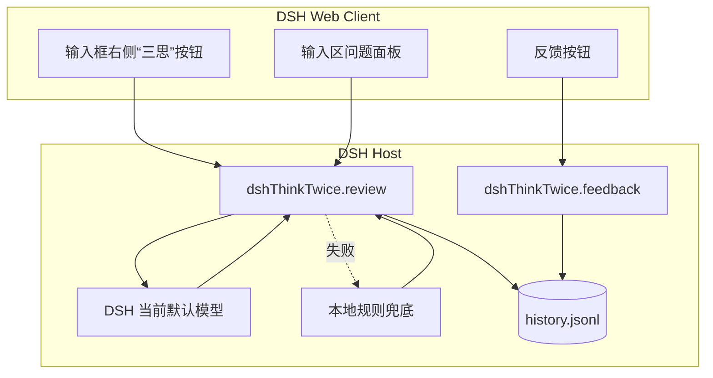

# DSH Think Twice / 三思

`dsh-think-twice` 是一个 DSH 输入框插件：它检查当前草稿，只提出问题，**不自动改写**。

目标不是让 AI 替你写，而是把“对方可能误解、追问或无法行动的地方”变成一两个你现在就能回答的问题。

## 当前 MVP

- 输入框右侧增加“三思”按钮；
- 一次审查同时检查语言、逻辑、信息完整性；
- 最多返回两个问题；
- 每个问题必须引用原文中的短句；
- 问题带有“问得对 / 我改了 / 不准”反馈；
- 不修改输入框、不自动替换文本；
- 优先跟随当前会话实际使用的模型，而不是全局默认模型；
- 模型不可用时自动退化为本地高置信度规则；
- 审查记录默认写入：

```text
<DSH_HOME>/dsh-think-twice/history.jsonl
```

## 交互



三思不锁定发送，也不拦截发送。它只在你主动点击时运行，因此不会拖慢普通输入。

## 安装

### 本地开发链接

```powershell
$env:DSH_HOME = 'E:\program\DeepSeek\.dsh'
& 'E:\program\DeepSeek\app\node_modules\.bin\dsh.cmd' plugin --profile web add link:E:/programs/dsh-think-twice
```

安装或修改 Host 侧代码后，需要重启一次 DSH Web 进程。

检查安装：

```powershell
$env:DSH_HOME = 'E:\program\DeepSeek\.dsh'
& 'E:\program\DeepSeek\app\node_modules\.bin\dsh.cmd' plugin --profile web list
```

### 立即测试纯规则逻辑

不启动 DSH 也可以测试本地兜底审查：

```powershell
node bin/review-demo.mjs "麻烦尽快把这个处理一下，然后发给他们。"
```

## 架构



插件不保存 API Key，也不直接访问模型供应商。模型调用走 DSH 已配置的 `ctx.llm` 路由；如果全局默认模型不可用，会先从当前会话日志里读取该会话实际使用的 provider/model，再尝试调用。

## 审查契约

```json
{
  "summary": "对方可能还会确认 2 件事。",
  "questions": [
    {
      "layer": "information",
      "severity": "high",
      "confidence": 0.86,
      "quote": "尽快",
      "question": "这里的“尽快”具体是哪个时间点前？",
      "why": "模糊时间会让对方无法安排优先级。"
    }
  ]
}
```

约束：

- `layer`：`language | logic | information`；
- `severity`：`high | medium | low`；
- 每个 `quote` 必须逐字出现在原文中；
- 最多两个问题；
- 低置信度问题直接丢弃；
- 没有高置信度问题时返回空数组，不为凑数制造问题。

## 已知边界

- 当前是 Web UI 插件，不包含全局语音录制；
- 当前没有新手教程、评分曲线和统计页；
- 当前反馈只写入本地 JSONL，还没有可视化统计；
- 模型质量仍然依赖 DSH 当前默认模型；
- 本地规则兜底只覆盖少量高置信度模式，不能替代语义审查；
- 历史记录含原文，默认只保存在本机，删除入口和设置页尚未实现。

## 验证

```powershell
node --test test/*.test.js
npm run check
node bin/review-demo.mjs "这个尽快弄一下，然后发给他们。"
```

## License

MIT

